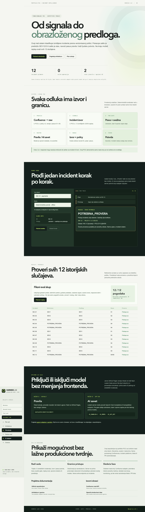
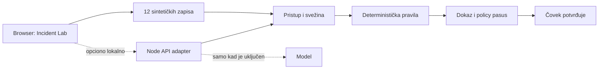

# Harness Lab — Agentic Engineering & Incident Intelligence POC

Javni, izvršivi portfolio projekat: interaktivna arhitektura harness/factory sistema, plan učenja i **read-only Incident Lab** koji daje proverljiv predlog ozbiljnosti za sintetičke incidente. Pokazuje šta sistem radi i kako se proverava, uz jasnu granicu prema budućoj Confluence integraciji i AI modelu.

**Isprobaj:** [Incident Lab](https://nokibuzz.github.io/agentic-harness-lab/dist/lab.html) · [Harness arhitektura](https://nokibuzz.github.io/agentic-harness-lab/dist/index.html) · [Second Brain](https://nokibuzz.github.io/agentic-harness-lab/dist/second-brain.html) · [Tvoj put](https://nokibuzz.github.io/agentic-harness-lab/dist/put.html).



## Problem → rešenje → dokaz

| Problem | Rešenje koje radi sada | Kako proveriti |
| --- | --- | --- |
| Incident predlog bez razloga | Čista funkcija vraća severity, razlog, polja izvora i pasus politike | Izaberi incident u [Lab-u](dist/lab.html) i prođi trace |
| Zastareo, sporan ili uskraćen podatak | Pre-gate zaustavlja klasifikaciju pre AI poziva | Pokreni INC-05, INC-09 i INC-12 |
| Promena pravila kvari ranije slučajeve | Replay poredi 12 fixturea sa referentnim oznakama | Klikni „Pokreni replay“ ili pokreni `npm test` |
| Tajne u javnom frontendu | Podrazumevana ruta nema ključ; opcioni adapter čita ključ samo iz server env | Pročitaj [ugovor adaptera](docs/AI_ADAPTER.md) i testove |

Ovo su sintetički slučajevi. Projekat **ne tvrdi** da je pregledao stvarne incidente, povezao Confluence ili automatizovao PR/merge.

## Pokretanje

Potreban je Node.js 20+; nema npm paketa ni instalacije zavisnosti.

```sh
npm run dev
```

Otvori `http://127.0.0.1:4173/lab.html`. Za testove:

```sh
npm test
```

Tri nastavna taba možeš otvoriti i direktno iz `dist/`. Incident Lab koristi statičke JSON fixturee, pa mu treba lokalni HTTP server ili GitHub Pages.

**Podrazumevano:** AI je isključen; nema naloga, tokena, poziva ka provajderu, stvarnih incidenata ni write operacija. Napredak u planu učenja čuva se u browseru i može se izvesti kao JSON.

**Opciono:** lokalni server ima OpenAI Chat Completions ili kompatibilan adapter. Uključuje se preko `AI_ENABLED=1`, `AI_MODEL` i `AI_API_KEY` u serverskom okruženju. Ključ se ne unosi u frontend. [Uputstvo, ugovor i ograničenja](docs/AI_ADAPTER.md).

## Arhitektura



Detalji su u [arhitekturi](docs/ARCHITECTURE.md). Sintetička politika je u [vežbi](vezbe/incidenti/policy-v3.md); [pure core](dist/incident-core.mjs) može se testirati bez servera. Testovi pokrivaju 12 slučajeva, granične uslove, uskraćen pristup, isključen AI i to da server ne vraća ključ klijentu.

## Šta sadrži

- [Incident Lab](dist/lab.html): funkcionalna trijaža, trace, citati, ljudski gate i replay.
- [Harness](dist/index.html): arhitektura chat/CLI/scheduler → trijaža → radnik → provera → review → merge gate; factory loop, model routing i ilustrativni workflowi.
- [Second Brain](dist/second-brain.html): izvori, raw/wiki/output, citati, svežina i predaja context packa.
- [Tvoj put](dist/put.html): osam nedelja i 40 detaljnih lekcija, konkretne komande, primeri, merljivi gateovi i lokalno praćenje napretka. Isti sadržaj je u [Markdown kursu](PUT.md).
- [PUT.md](PUT.md), [UCENJE.md](UCENJE.md), [SECOND_BRAIN.md](SECOND_BRAIN.md) i [VODIC.md](VODIC.md): detaljna uputstva.
- [vezbe/incidenti/](vezbe/incidenti/README.md): sintetička Confluence politika, 12 incidenata, referentne oznake i PR review diff.

## Put prema stvarnom sistemu

1. Potvrdi internu severity matricu, vlasništvo i granice podataka; izgradi istorijski eval skup.
2. Poveži samo odobren read-only Confluence i incident adapter, uz permission check, provenance i audit.
3. Uporedi determinističku i opcionu AI rutu na istim slučajevima; meri lažne kritične odluke, citate, vreme i cenu.
4. Tek zatim razmatraj draft ticket, izolovanog coding workera, PR review i uski merge gate iz Harness plana.

Istraživanje i atribucije su u sekcijama „Izvori“ tabova. Relevantni obrasci: [Atlassian Confluence read API](https://developer.atlassian.com/cloud/confluence/rest/v2/api-group-page), [Atlassian incident response](https://www.atlassian.com/incident-management/handbook/incident-response), [Zach Lloyd o factory engineeringu](https://www.warp.dev/blog/build-production-software-factory), [Karpathy LLM Wiki](https://gist.github.com/karpathy/442a6bf555914893e9891c11519de94f), [Lauren Tan Maven radionica](https://maven.com/p/e23d9c/how-cursor-turned-ai-agents-into-better-engineers), [gstack](https://github.com/garrytan/gstack) i [pstack](https://github.com/cursor/plugins/blob/main/pstack/README.md).
