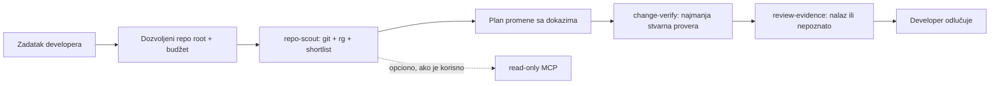

# Drugi portfolio projekat: Repo Scout Kit

**Kada počinješ:** posle Dana 10, na kraju druge nedelje glavnog [osmonedeljnog kursa](PUT.md). Ovo je plan za **zaseban budući GitHub repozitorijum**, ne instaliran alat. Prva nedelja ti je gotovo poznata: sutra uradi samo [brzu proveru](#brza-provera-prve-nedelje), pa pređi na Dane 6–10 ako prođeš.

## Problem koji rešavaš

Coding agent često pročita previše fajlova pre nego što razume mali zadatak. Drugi problem je suprotan: izostavi ključni fajl i napravi pogrešan PR. Repo Scout Kit treba da pronađe **najmanji proverljiv skup relevantnih fajlova**, da prikaže zbog čega ih je izabrao, pa da vodi agenta kroz proveru diff-a. Cilj je da smanji nepotrebno čitanje **bez pada kvaliteta**. Paket u početku ne pravi sopstvene API pozive, nema mrežni servis ni automatske write akcije. Agent koji koristi skillove i dalje troši tokene; zato ih meriš.

Uzorci iz kojih učiš, uz sopstveni dizajn i atribuciju:

- [gstack](https://github.com/garrytan/gstack): jasan redosled plan → review → QA → ship. Koristi taj redosled za oblik izlaza; ne kopiraj njegove skill fajlove ili ime proizvoda.
- [pstack](https://github.com/cursor/plugins/blob/main/pstack/README.md): uski verification skill, rad iz ponovljenih grešaka i poseban kontekst za delegata. Napiši svoje procedure za svoj problem.
- [Cursor Skills](https://prod.cursor.com/help/customization/skills) i [Cursor Plugins](https://cursor.com/docs/plugins): skill je folder sa `SKILL.md`; plugin može da spakuje skillove, agente i MCP server. Prvo isporuči skillove; plugin manifest je kasniji korak.
- [MCP TypeScript SDK](https://ts.sdk.modelcontextprotocol.io/server): lokalni `stdio` server je dobar početak kada zaista treba stabilan alat koji klijent poziva. `stdout` je protokol; logovi idu na `stderr`.
- [OpenAI vodič za eval skillova](https://developers.openai.com/blog/eval-skills) i [gstack eval rezultati](https://github.com/garrytan/gstack-evals): meri aktiviranje, izvršene korake, rezultat i trošak. Učitavanje skilla samo po sebi nije dokaz da rešava zadatak.

## Šta isporučuješ u v0.1

**Tri skilla, bez MCP-a:**

1. `repo-scout`: najpre `git status`, `git diff --name-only`, `rg --files` i ciljane `rg` pretrage; vraća najviše 12 kandidata sa razlogom i 3 otvorena pitanja. Ne čita ceo repozitorijum.
2. `change-verify`: iz diff-a bira najmanju proveru koja može uhvatiti regresiju: unit, API, browser ili kombinaciju. Vraća komandu i rezultat. Ne proglašava „radi“ bez provere.
3. `review-evidence`: za PR razdvaja dokazanu grešku, hipotezu i komentar bez nalaza; za svaki prihvaćeni nalaz traži liniju, reprodukciju i uticaj.

**Jedan opcioni delegat:** `evidence-checker` ponovo čita samo shortlist, diff i kriterijum prolaza. Roditelju vraća najviše 10 redova. Ne uređuje fajlove. Koristi ga samo kada nezavisna provera ima razlog, npr. promena policy gatea ili velik rizik.

**MCP v0.2, tek posle evaluacije:** lokalni read-only `stdio` server sa najviše dva alata: `repo_map(root)` i `changed_files(root, base_ref)`. MCP rešava ponovljivo strukturirano čitanje; ne koristi se da ponovi običan shell bez koristi. Ne izlaže `execute_command`, mrežu, GitHub token ni write alat.

## Kako radi jedan zahtev



U izlazu svakog skilla su `task_id`, `repo_sha`, `selected_paths`, `reason`, `commands_run`, `unknowns`, `next_check` i `result`. Ako repo nema Git, alat kaže da je to ograničenje i traži drugačiji plan, umesto da nagađa promene.

## Brza provera prve nedelje — sutra, 90 minuta

Prođi Dane 1–5 ubrzano, ali tek kada možeš da pokažeš ove rezultate:

1. `npm test` prolazi; znaš gde je [Incident Lab core](dist/incident-core.mjs) i možeš objasniti ulaz/izlaz funkcije.
2. `git status`, `git diff` i `rg "analyzeIncident" dist tests` rade u tvojoj kopiji; možeš naći test koji pokriva uskraćen pristup.
3. U browseru prođeš INC-02 i INC-12 i objasniš zašto drugi staje. Nacrtaš tok pristup → svežina → pravilo → čovek.
4. Izgovoriš razliku: skill je postupak, delegat zaseban kontekst, MCP je alat/protokol za strukturisane pozive.

Ako nešto od toga zapne, odradi baš taj Dan 1–5 normalnim tempom. Obeleži dan kao završen samo uz svoj dokaz; preskakanje čitanja nije dokaz znanja.

## Raspored izrade posle Dana 10

Radi **dva dodatna bloka po 90 minuta nedeljno** tokom Nedelja 3–6, ili jedan blok od 2–3 sata ako ti tako odgovara. Glavni kurs ostaje primarni. Ako nemaš vremena, pomeri v0.1 bez preskakanja evaluacije.

| Kada | Tačno šta radiš | Sačuvaj | Uslov za nastavak |
| --- | --- | --- | --- |
| Kraj Nedelje 2, 60 min | Izaberi ime, napiši problem, tri korisnička scenarija i šta nećeš automatizovati. Napravi prazan zaseban repo. | `README.md`, `docs/problem.md` | Stranac razume kome alat pomaže i šta ne radi. |
| Nedelja 3, blok A | Na dva mala javna/sintetička repoa ručno uradi skeniranje: broj otvorenih fajlova, relevantni fajlovi, promašeni fajlovi, vreme. | `evals/baseline.csv` | Imaš baseline pre bilo kog skilla. |
| Nedelja 3, blok B | Napiši `skills/repo-scout/SKILL.md` sa jasnim triggerom, redosledom `git`/`rg`, limitom 12 fajlova i stop uslovima. Testiraj eksplicitno i implicitno pozivanje. | skill v0 + dva tracea | Skill se aktivira kad treba i ne bira sebe za nerelevatan zadatak. |
| Nedelja 4, blok A | Napiši `change-verify` i `review-evidence`; uzmi tri sintetička diff-a, uključujući lažan alarm. | tri skilla, `examples/` | Svaki komentar ima proveru; „ne znam“ radi. |
| Nedelja 4, blok B | Napiši jednostavan `install.sh --target cursor|codex --scope project --dry-run`; kloniraj repo u čist folder i instaliraj. | instalacioni test | Instalacija ne prepisuje postojeći skill i može se ukloniti. Objavi v0.1. |
| Nedelja 5, blok A | Poredi istog agenta i iste zadatke sa/bez skilla, tri ponavljanja. Beleži relevantne fajlove, propuštene fajlove, tokene, vreme, rezultat. | `evals/paired-results.csv` | Imaš paired tabelu, ne anegdotu. |
| Nedelja 5, blok B | Ispravi samo jednu najveću grešku u triggeru ili shortlisti; ponovi iste zadatke i jedan holdout. | v0.2 diff + izveštaj | Nema kritičnog promašenog fajla u holdout skupu. |
| Nedelja 6, blok A | Odluči da li shell skill ima problem koji MCP rešava. Ako da, napravi read-only `stdio` server sa `repo_map` i `changed_files`. | MCP prototip + test | Isti ulaz daje deterministički izlaz; nema write/mrežnog alata. |
| Nedelja 6, blok B | Izmeri MCP overhead i bezbednosne slučajeve; napiši README demo, primer konfiguracije i release note. | v0.2 ili odluka „MCP nije potreban“ | Posetilac može instalirati i ponoviti demo iz README-ja. |

## Minimalna struktura budućeg repozitorijuma

```text
repo-scout-kit/
├── README.md
├── LICENSE
├── install.sh
├── skills/
│   ├── repo-scout/SKILL.md
│   ├── change-verify/SKILL.md
│   └── review-evidence/SKILL.md
├── agents/evidence-checker.md
├── examples/
│   ├── good-shortlist.md
│   └── failed-shortlist.md
├── evals/
│   ├── tasks.jsonl
│   ├── baseline.csv
│   ├── paired-results.csv
│   └── rubric.md
└── mcp/                 # tek ako eksperiment opravda
```

Početak jednog skilla:

```md
---
name: repo-scout
description: Use when a coding task needs a bounded map of an unfamiliar repository before editing. Do not use for a named, already-open file.
---
1. Read the task and state the search question.
2. Run git status and git diff --name-only before any broad scan.
3. Use rg --files with a relevant path/glob; inspect at most 12 candidate files.
4. Return path, reason, evidence, unknowns and next check.
5. Stop if the root is outside the allowed checkout or the evidence is insufficient.
```

Ovo je originalna nastavna skica, ne kopija tuđeg skilla. Za Codex i Cursor proveri aktuelne putanje instalacije iz [OpenAI skill dokumentacije](https://developers.openai.com/plugins/build/skills) i [Cursor skill dokumentacije](https://prod.cursor.com/help/customization/skills) pre pisanja installera.

## Merenje: kako dokazuješ da paket vredi

Pripremi najmanje **12 zadataka u 3 klase**: poznat fajl (skill bi trebalo da se uzdrži), nepoznat bug (treba shortlist), PR review (treba dokaz). Dodaj **4 negativna slučaja**: `.env` fajl, repo bez Gita, ogromni generated folder i putanju van root-a. Pokreni isti model, effort, budžet, početni SHA i zadatak sa/bez paketa. Redosled A/B rotiraj; radi najmanje tri ponavljanja po zadatku kada koristiš model. Ne koristi rezultate prvog pokušaja kao tvrdnju o opštem poboljšanju.

| Metrika | Kako računaš | Šta je prolaz |
| --- | --- | --- |
| Relevant file recall | pronađeni potrebni fajlovi / svi potrebni fajlovi | Nema propuštenog kritičnog fajla u eval skupu. |
| Precision shortliste | relevantni otvoreni fajlovi / svi otvoreni fajlovi | Veća od baselinea ili jasna ušteda bez pada recall-a. |
| Ishod zadatka | test + stvarni browser/API dokaz | Ne sme pasti zbog skilla. |
| Tokeni i vreme | ukupno parent + delegat + retries + alati | Prikaži medijanu i raspodelu; ušteda je cilj, ne unapred dokazana tvrdnja. |
| Aktiviranje skilla | implicitno/eksplicitno/negativni prompt | Pozitivni slučajevi aktiviraju, negativni ne. |
| Bezbednost | read-only i root granica | 0 write poziva i 0 čitanja tajni u test slučajevima. |

Ciljna hipoteza za v0.1: **najmanje 20% manje medijalnih ulaznih tokena pri istom uspehu** na vlastitom eval skupu. Ako rezultat ne prođe, objavi i to kao nalaz; sa malim skupom ne tvrdi statističku sigurnost. Računaj i vreme skeniranja, ne samo tokene. [OpenAI skill eval vodič](https://developers.openai.com/blog/eval-skills) daje obrazac `prompt → run → check → score`, a [gstack-evals](https://github.com/garrytan/gstack-evals) pokazuje zašto je bitno razlikovati „skill je otvoren“ od „zadatak je bolje rešen“.

## Bezbednosni i instalacioni ugovor

Planirani README za **budući** repozitorijum treba da pokaže komande ovog oblika. One još nisu dostupne: prvo moraš napisati i testirati `install.sh`, pa zameniti `<tvoj-nalog>` i putanju stvarnim vrednostima.

```sh
git clone https://github.com/<tvoj-nalog>/repo-scout-kit.git
cd repo-scout-kit
./install.sh --target cursor --scope project --project /putanja/do/probnog-repoa --dry-run
./install.sh --target cursor --scope project --project /putanja/do/probnog-repoa
./install.sh --target cursor --scope project --project /putanja/do/probnog-repoa --uninstall
```

Za Codex probaj isti ugovor sa `--target codex`. Installer mora da ispiše gde je kopirao fajlove i kako se poništava instalacija; na sukob imena izlazi bez prepisivanja. Testiraj ga u privremenom repozitorijumu pre javnog uputstva.

- Installer prvo pokazuje promene sa `--dry-run`, zatim kopira samo izabrane skillove u projekat; nikada tiho ne prepisuje istoimeni folder. Napiši `uninstall` i test u čistom folderu.
- Nema `curl | bash` u uputstvu za korisnika. Korisnik najpre klonira GitHub repo, pročita README i instalacioni skript.
- `repo-scout` poštuje Git root, `.gitignore`, limit broja fajlova i veličine izlaza. Ne otvara `.env`, ključeve ili privatne logove; negativni test proverava odbijanje.
- MCP, ako postoji, ostaje lokalni `stdio` proces. Nema arbitrary command execution, HTTP servera, write Git/issue/PR alata ili tokena. Strogo proverava root i argumente, odgovara ograničenim JSON-om.
- Ako package ne radi u Cursoru i Codexu pod istim putanjama, dokumentuj podržanu platformu za svaku verziju. Ne tvrdi univerzalnu kompatibilnost.
- U LICENSE i README napiši atribuciju za ideje iz gstack/pstack; ne preuzimaj njihove interne fajlove bez odgovarajuće licence i navođenja.

## Portfolio demo: 4 minuta

1. U svežem probnom repozitorijumu pokaži kloniranje Repo Scout Kita, `--dry-run`, instalaciju i proveru da se skill vidi u agentu.
2. Pokaži zadatak „Pronađi gde se odlučuje severity za INC-02“: bez skilla i sa skillom, uz isti početni SHA.
3. Pokaži shortlist: zašto baš ti fajlovi, koji su odbijeni i šta još nije poznato.
4. Pokaži `change-verify` na jednom diffu i `review-evidence` na lažnom alarmu.
5. Otvori eval tabelu i reci stvarni rezultat, uključujući neuspehe i cenu delegata. Ako MCP nije doneo korist, objasni zašto nije u v0.1.

**Gotovo je kada** drugi developer može pratiti README, instalirati paket bez tajni, ponoviti tri scenarija i proveriti tvoje brojke. To je drugi portfolio dokaz pored [Incident Lab-a](dist/lab.html).
