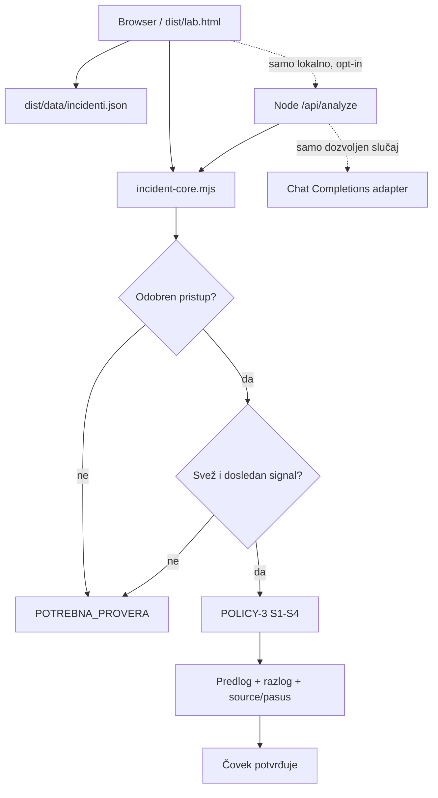

# Arhitektura: od nastavnog POC-a do incident analitičara

## Izvršivi deo danas

Pure funkcija `analyzeIncident(incident)` ne čita mrežu i ne menja stanje. Redosled je važan: pristup → svežina → sukob izvora → klasifikacija → dokaz. Ako je pristup uskraćen, izlaz ne sadrži polja incidenta osim ID-a i stanja pristupa. Zastareo ili sporan signal ne stiže do AI provajdera. Svi predlozi imaju ljudski gate.

Javni GitHub Pages prikaz učitava samo sintetičke fixturee. Na njemu AI adapter nije dostupan. Lokalni `npm run dev` servira isti frontend i opciono izlaže `GET /api/capabilities` i `POST /api/analyze`. Post prima isključivo `{"id":"INC-02"}` iz unapred poznatog skupa, nikakav slobodan tekst, URL ili Confluence dokument. Server čuva ključ u procesu i nikada ga ne šalje u JSON odgovoru.

Pošto su javni fixturei statički JSON, njihov `access` flag u browseru je nastavni primer za odluku i prikaz, a ne zaštita samog JSON fajla. Za stvarne podatke pravo čitanja mora biti provereno na izvoru i na serverskom adapteru pre učitavanja ili slanja sadržaja.

## Ugovori

**Ulaz:** sintetički incident sa `id`, `access`, `signal_age_minutes`, `duration_minutes`, `impact`, `data_loss`, `security_or_privacy`, `workaround` i opcionim `conflicting_sources`. Razvojni adapter za stvarne sisteme bi morao normalizovati podatke na ovaj ugovor i prvo proveriti pravo čitanja.

**Izlaz:** `id`, `status` (`proposed` / `needs_review`), `severity`, `reason`, `policy` (`id`, `version`, `clause`), `evidence`, `humanGate` i `trace`. AI odgovor je posebno polje `advice`; ne zamenjuje baseline. Neslaganje se prikazuje za pregled.

**Replay:** `dist/data/expected.json` je zamrznuta referenca za 12 slučajeva. `npm test` proverava i da javni fixture odgovara izvornom nastavnom JSON-u. Replay u browseru prikazuje razlike po incidentu. Ovo je regresioni signal za POC, ne validacija stvarnog incident procesa.

## Granice

| Već implementirano | Namerna granica |
| --- | --- |
| Read-only trijaža na sintetičkom skupu | Nema stvarnog Confluence ili incident naloga |
| Citiranje `POLICY-3` i polja incidenta | Politika je izmišljena; interna pravila imaju prednost |
| Server-side env za opcioni ključ | Nema ključa u repozitorijumu ili browseru |
| Pre-gate pre modela | Model nema pravo da menja status ili severity |
| Replay i testovi | Nema tvrdnje o produkcionoj tačnosti |

## Put do stvarne primene

1. Uz odobrenje vlasnika podataka izabrati Confluence prostore, incident sistem i read scope. Atlassian [GET pages API](https://developer.atlassian.com/cloud/confluence/rest/v2/api-group-page) vraća samo stranice koje korisnik sme videti; integracija mora sačuvati stranicu, verziju, datum i pasus.
2. Napraviti adaptere `ConfluenceReader` i `IncidentReader` koji emituju normalizovane read-only zapise. Bez podrazumevanog upisa, bez slanja privatnih dokumenata modelu dok nema klasifikacije podataka i odobrenog provajdera.
3. Zameniti sintetičku politiku potvrđenom internom matricom. Sastaviti istorijski eval skup sa ljudskim referentnim oznakama, uključujući kritične i neodređene slučajeve.
4. Tek kada read-only tok ima merenu pouzdanost, razdvojeno dodati draft ticket, izolovanog coding workera, verifikaciju, review i merge gate iz [Harness plana](../VODIC.md). Svaka nova dozvola ima svoj gate.

## Zašto ovaj raspored rešava problem

Teškoća nije samo klasifikacija teksta. Incident predlog zavisi od verzije pravila, prava pristupa, svežine signala, obima uticaja i mogućnosti da sistem kaže da nema dovoljno dokaza. Pure core i pre-gate čine te obaveze vidljivim. AI ruta može poboljšati tumačenje složenih dozvoljenih slučajeva, ali rezultat ostaje savet uz izvor, a ne promenu stanja.
